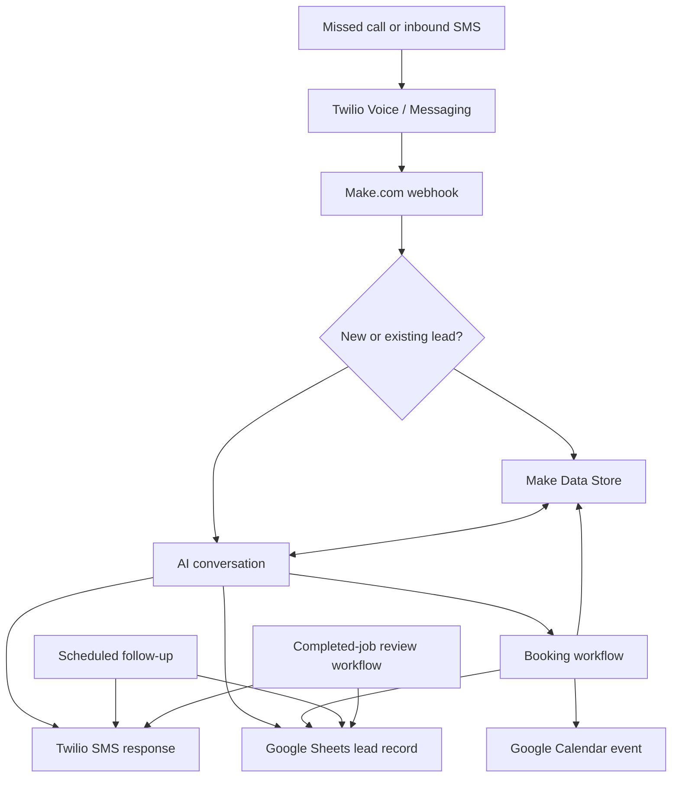

# Make.com AI Receptionist for Plumbing Services

> An AI-assisted automation for recovering missed calls, qualifying plumbing leads, booking appointments, sending follow-ups, and requesting customer reviews.

**Make.com** · **Twilio** · **OpenAI / Make AI Agents** · **Google Sheets** · **Google Calendar** · **Make Data Stores**

## Overview

Local plumbing businesses can lose customers when calls go unanswered. This project demonstrates a Make.com automation that follows up with callers by SMS, collects the information needed to qualify a service request, and coordinates the next step.

The workflow is designed for US-based plumbing services and can be adapted for other appointment-based businesses, including HVAC, electrical, cleaning, and home-maintenance companies.

### What it does

- Sends an SMS after a missed call or inbound message.
- Uses an AI-assisted conversation to collect customer and service details.
- Stores lead and conversation context for continued messaging.
- Tracks lead status and information in Google Sheets.
- Coordinates appointment requests with Google Calendar.
- Identifies potentially urgent plumbing issues for escalation.
- Sends scheduled follow-ups to leads who have not booked.
- Sends review-request messages after eligible jobs.

> **Important:** This repository documents the workflow design through Make.com scenario screenshots. It does not include exported Make blueprints, credentials, customer records, webhook secrets, or a verified production deployment. The screenshots alone do not prove that all live connections, prompts, filters, safeguards, or follow-up messages are configured correctly.

## How the workflow works



## Make.com scenarios

The design is divided into five scenarios. Each screenshot shows the visible module-level flow.

### 1. New lead capture and initial response


**Visible flow:** Webhook → Make Data Store → Google Sheets → Twilio → HTTP.

Receives an incoming event, creates or replaces the lead record, logs the lead in Google Sheets, and sends an initial SMS. The destination of the final HTTP request is not visible in the screenshot.

### 2. AI SMS conversation and lead updates


**Visible modules:** Webhooks, Data Store, Router, Tools, Twilio, Array Aggregator, JSON, OpenAI, Make AI Agents, Google Sheets, and HTTP.

Retrieves conversation context, processes an incoming message, generates an AI response, extracts structured lead information, sends an SMS, and saves the updated state. The screenshot shows OpenAI and Make AI Agents in separate branches; their prompts and model settings are not included.

The intended data includes the customer's name, phone number, service issue, address, urgency, preferred appointment time, and next workflow action.

### 3. Appointment booking and record synchronization


**Visible flow:** Webhook → Google Calendar → Google Sheets → Twilio → Make Data Store.

Processes booking details, creates a calendar event, updates the matching lead, sends a booking-related SMS, and synchronizes the stored record.

> **Booking safeguard:** Availability checks, time-zone handling, duplicate prevention, and customer/owner confirmations must be verified before using this workflow in production. Creating a calendar event alone does not prove that conflict checks are enabled.

### 4. Scheduled SMS follow-ups


**Visible flow:** Scheduled Google Sheets search → Iterator → JSON transformation → Date calculation → Router → Twilio / Google Sheets.

Calculates how long a lead has been waiting and routes eligible records through follow-up stages. The screenshot shows five stages labeled **1st** through **5th**.

The intended requirement is a 21-day follow-up sequence. A live implementation should stop messages when a customer books, opts out, or is otherwise no longer eligible.

### 5. Google review request


**Visible flow:** Google Sheets → Tools → Twilio → Make Data Store → Google Sheets.

Watches for a lead-data change, sends a review-request SMS, and updates the related records. The live configuration should verify that requests are sent only after job completion and only once per customer.

## Lead data model

The workflow can use the following fields in Google Sheets and Make Data Stores:

| Field | Description |
| --- | --- |
| `phone` | Normalized customer phone number and lookup key |
| `name` | Customer name |
| `issue_description` | Description of the requested plumbing service |
| `address` | Service location |
| `urgency` | Normal, urgent, or emergency classification |
| `preferred_time` | Requested appointment window |
| `appointment_time` | Confirmed appointment date and time |
| `status` | `new`, `in_conversation`, `no_response`, `booked`, or `completed` |
| `created_at`, `updated_at` | Lead timestamps |
| `last_contact_at` | Most recent inbound or outbound interaction |
| `review_requested` | Whether a review request has been sent |

Useful internal fields include `twilio_message_sid`, `twilio_call_sid`, `calendar_event_id`, `follow_up_stage`, `emergency_flag`, and `opted_out`. These support de-duplication, retries, escalation, booking consistency, and messaging preferences.

## Technology

| Tool | Purpose |
| --- | --- |
| Make.com | Webhooks, routing, filters, scheduling, transformations, and orchestration |
| Twilio Voice and Messaging | Missed-call events and SMS communication |
| OpenAI / Make AI Agents | Conversational responses and structured lead intake |
| Make Data Stores | Lead and conversation state |
| Google Sheets | Lead tracking and operational updates |
| Google Calendar | Appointment event creation |
| HTTP / JSON modules | Structured payloads and downstream integrations |

## Configuration and deployment

This is a workflow showcase, not a one-click Make.com import. A working deployment requires authorized accounts and connections for Make.com, Twilio, OpenAI, Google Sheets, and Google Calendar.

1. Configure a Twilio number and inbound voice/messaging webhooks.
2. Create the required Make.com webhooks and connect the service modules.
3. Create the Google Sheets lead tracker and Make Data Store schema.
4. Configure AI prompts, conversation history, JSON extraction, routing, and emergency detection.
5. Configure business hours, time zone, calendar availability, and booking rules.
6. Configure follow-up timing, opt-out handling, and review-request eligibility.
7. Test end to end with synthetic leads and non-sensitive test phone numbers.

## Validation checklist

Before calling the workflow production-ready, verify:

- [ ] A missed call creates the expected event and initial SMS.
- [ ] Incoming replies retrieve the correct conversation context.
- [ ] Duplicate callbacks do not create duplicate leads or bookings.
- [ ] AI responses produce valid structured data with safe handling for missing fields.
- [ ] Emergency issues trigger the intended owner notification.
- [ ] Calendar conflicts and time zones are enforced.
- [ ] Booking confirmations reach the intended recipients.
- [ ] Follow-ups run on the intended 21-day schedule and stop after booking or opt-out.
- [ ] Review requests are sent only after completion and do not repeat unintentionally.
- [ ] Webhook authentication, retries, logging, and error handling are enabled.

## Repository structure

```text
Make.com-AI-Receptionist-for-US-Plumbing-Services/
├── README.md
└── screenshots/
    ├── scenario1.png
    ├── scenario2.png
    ├── scenario3.png
    ├── scenario4.png
    └── scenario5.png
```

## Security and privacy

Never commit API keys, webhook secrets, Make.com connection exports containing credentials, real phone numbers, private customer messages, or live lead spreadsheets. Use synthetic data for demonstrations and testing.

Production deployments should also address messaging consent, customer opt-outs, webhook authenticity, access control, data retention, privacy requirements, and clear escalation procedures for emergencies.

## Scope and limitations

- This workflow focuses on texting customers after missed calls; it is not a real-time AI voice receptionist.
- The screenshots document the visible scenario structure, not every live configuration detail.
- Prompts, credentials, exported blueprints, customer data, and production test results are not included.
- Emergency detection and booking safeguards require careful testing before deployment.

## License

No license has been specified yet. Add a license file before redistributing this project.
