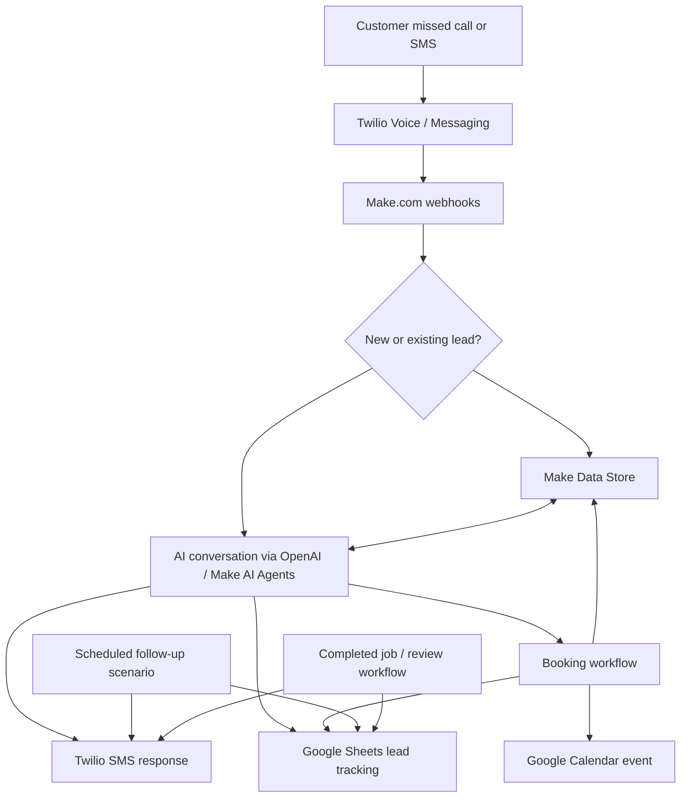
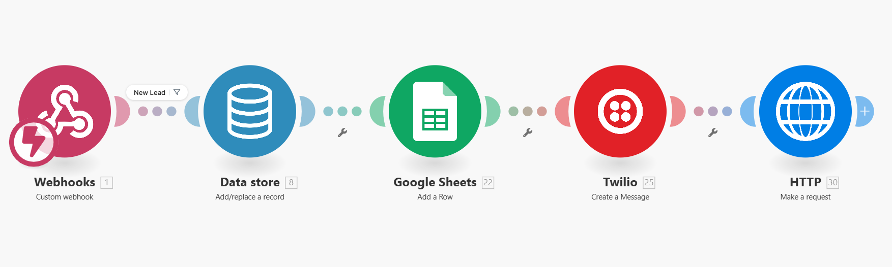
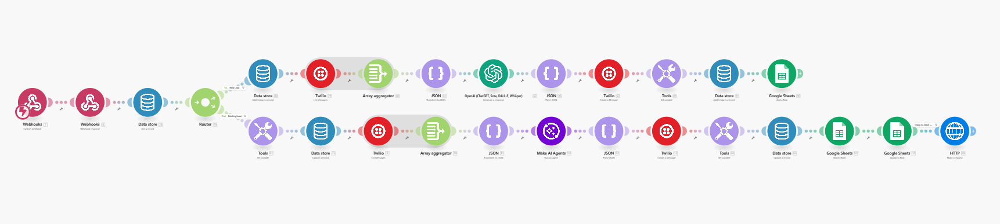
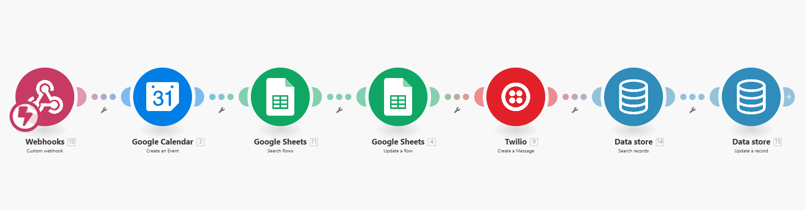
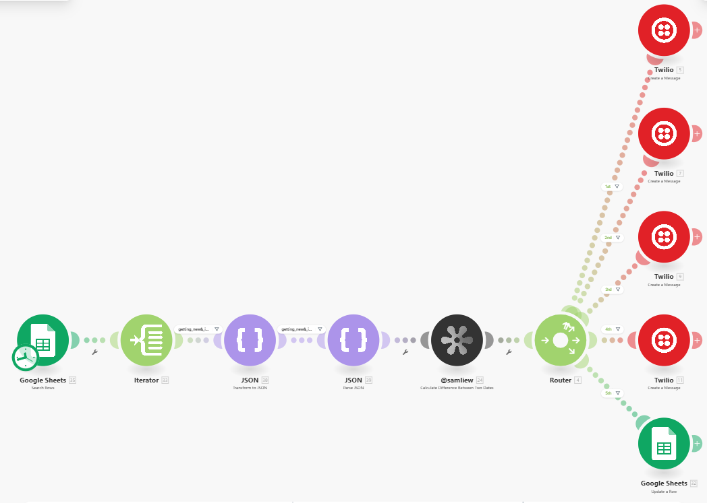
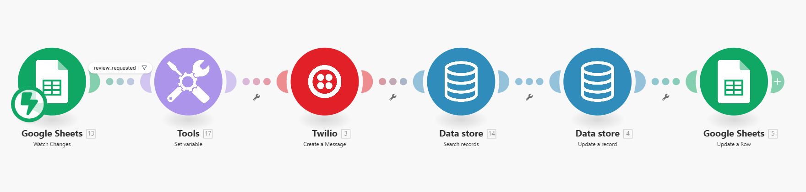

# AI Receptionist System for US-based Plumbing Service

**Make.com · Twilio · OpenAI · Google Sheets · Google Calendar · Make Data Stores**

A multi-scenario automation designed to help local service businesses respond to missed calls and incoming texts, qualify leads through AI-powered SMS conversations, coordinate appointments, follow up on unbooked inquiries, and request reviews after completed jobs.

The initial use case is a **plumbing business**, but the workflow can be adapted for other appointment-based services such as HVAC, electrical work, cleaning, and home maintenance.

> **Project documentation:** This repository shows the workflow structure through five Make.com scenario screenshots. The screenshots establish which modules and branches were configured, but do not independently verify live webhook settings, message delivery, AI prompt quality, the entire 21-day cadence, or production-readiness. Exported Make blueprints, credentials, and customer records are **not** included.

## Overview

When a customer calls and the business cannot answer, the intended workflow uses a Twilio call event to initiate an SMS conversation. Incoming replies are handled by a Make.com webhook and routed through the appropriate AI conversation branch. Make Data Stores retain lead and conversation state, while Google Sheets serves as a lead-tracking workspace.

Once an appointment is confirmed, a booking scenario creates a Google Calendar event and updates the lead record. Separate scheduled scenarios handle follow-ups and review requests.

### System architecture



## What the system is designed to do

- **Missed-call text-back:** follow up on missed calls and handle inbound SMS through Twilio and Make.com webhooks.
- **Conversational lead intake:** gather the customer's name, phone number, service issue, address, urgency, and preferred appointment time.
- **Conversation continuity:** store and retrieve customer-specific context through Make Data Stores.
- **Lead tracking:** create or update a Google Sheets record as the conversation progresses.
- **Appointment coordination:** pass structured booking details to a Make scenario that creates a Google Calendar event and updates records.
- **Urgent-job escalation:** identify issues such as leaks, burst pipes, flooding, or sewage problems and prioritize owner notification (requires rule and notification testing).
- **Follow-up messaging:** send scheduled SMS reminders to leads who have not booked.
- **Review requests:** send an SMS review invitation and update tracking records after a job is eligible for review.

## Make.com scenarios

The implementation is organized into **five scenarios**. Each screenshot below shows the module-level automation design.

### Scenario 1: New lead capture and initial response



**Visible module flow:** Webhook → Make Data Store (add/replace record) → Google Sheets (add row) → Twilio (create message) → HTTP (make request).

This scenario receives an incoming event, establishes a lead record, logs it in Google Sheets, and sends an outbound SMS. The last HTTP module provides a downstream request step whose destination is not visible in the screenshot.

### Scenario 2: AI-powered SMS conversation and lead updates



**Visible modules:** Webhooks, Data Store, Router, Tools, Twilio, Array Aggregator, JSON, OpenAI, Make AI Agents, Google Sheets, and HTTP.

This is the main conversational workflow. It retrieves stored context and uses conditional branches to process messages, prepare structured context, generate an AI response, parse the result, send an SMS, and persist lead information. The screenshot shows both an **OpenAI** module and a **Make AI Agents** module in different branches; it does not reveal their underlying prompts or model settings.

The intended extracted fields include customer details, the reported problem, urgency, preferred time, and the next workflow action. The exact JSON schema must match the configured prompts and mappings.

### Scenario 3: Appointment booking and record synchronization



**Visible module flow:** Webhook → Google Calendar (create event) → Google Sheets (search rows) → Google Sheets (update row) → Twilio (create message) → Data Store (search records) → Data Store (update record).

This scenario processes structured booking information, creates an event, updates the matching lead, sends a booking-related SMS, and synchronizes the saved state. The screenshot shows one Twilio messaging module; separate customer and business-owner confirmations should be verified against the live configuration.

> **Booking safeguard:** Confirm availability and prevent duplicate bookings before treating an AI-suggested time as reserved. Calendar event creation alone does not prove that conflict checks are configured.

### Scenario 4: Scheduled SMS follow-ups



**Visible module flow:** Scheduled Google Sheets search → Iterator → JSON transformation/parsing → date-difference calculation → Router → Twilio SMS branches / Google Sheets update.

The scenario calculates how long a lead has been waiting and routes eligible records to follow-up messages. The screenshot visibly contains five routed stages, labeled **1st** through **5th**, with several Twilio message modules.

The **21-day SMS sequence** is a project requirement. The screenshot alone does not establish that every message across all 21 days has been configured. A production implementation should also stop follow-ups when a customer books, opts out, or otherwise becomes ineligible.

### Scenario 5: Google Review request



**Visible module flow:** Google Sheets (watch changes) → Tools (set variable) → Twilio (create message) → Data Store (search records) → Data Store (update record) → Google Sheets (update row).

This workflow watches for a change in lead data, sends a review-request SMS, then updates the associated records. The visible filter is labeled `review_requested`; the exact completed-job eligibility condition should be checked in the live scenario to ensure requests are sent only once, after the job is complete.

## Lead data model

A practical Google Sheets / Data Store record for this workflow contains:

| Field | Purpose |
| --- | --- |
| `phone` | Normalized customer phone number and lead lookup key |
| `name` | Customer name |
| `issue_description` | Description of the requested service |
| `address` | Service location |
| `urgency` | Normal / urgent / emergency classification |
| `preferred_time` | Requested appointment window |
| `appointment_time` | Confirmed appointment date and time |
| `status` | `new`, `in_conversation`, `no_response`, `booked`, or `completed` |
| `created_at`, `updated_at` | Lead timestamps |
| `last_contact_at` | Most recent outbound or inbound interaction |
| `review_requested` | Whether a review SMS has already been requested |

Recommended additional internal fields include `twilio_message_sid`, `twilio_call_sid`, `calendar_event_id`, `follow_up_stage`, `emergency_flag`, and `opted_out`. These support de-duplication, safe retries, booking consistency, escalation, and messaging preferences; the screenshots do not confirm all of these fields are present.

## Technology stack

| Service | Role |
| --- | --- |
| **Make.com** | Webhooks, routing, filters, scheduling, JSON transformation, and scenario orchestration |
| **Twilio Voice + Messaging** | Missed-call event integration and SMS communication |
| **OpenAI / Make AI Agents** | Conversation generation and structured lead intake |
| **Make Data Stores** | Persistent lead and conversation state |
| **Google Sheets** | Lead tracking, statuses, and operational updates |
| **Google Calendar** | Appointment event creation |
| **HTTP / JSON modules** | Structured payloads and downstream integrations |

## Configuration and deployment

This repository is a **workflow showcase**, not a one-click Make.com import. To deploy an equivalent system, you need authorized accounts and credentials for Make.com, Twilio, OpenAI, Google Sheets, and Google Calendar, along with the original scenario configuration or exported blueprints.

1. Set up a Twilio number and configure the appropriate inbound messaging webhook and missed-call/voice status events.
2. Create Make.com webhook endpoints and connect Twilio, OpenAI, Google Sheets, Google Calendar, and Data Store modules.
3. Define a stable lead schema and create the tracking spreadsheet and Data Store records.
4. Configure the AI prompts, JSON extraction, message-history retrieval, routing conditions, and emergency detection.
5. Configure appointment handling using the business's time zone, working hours, calendar availability, and booking rules.
6. Configure scheduled follow-ups and stop conditions, then review-request eligibility and suppression rules.
7. Run end-to-end tests using non-sensitive test numbers and synthetic leads before using the scenarios with customers.

**Do not commit** API keys, Make connection exports containing secrets, webhook secrets, real phone numbers, private customer messages, or live lead spreadsheets to a public repository.

## End-to-end validation checklist

The following should be verified in Make.com execution history and Twilio/Google service logs before claiming production readiness:

- [ ] A missed call produces the correct inbound event and timely initial SMS.
- [ ] Incoming SMS replies retrieve the correct conversation context.
- [ ] Duplicate callbacks do not create duplicate leads or bookings.
- [ ] AI replies extract required fields into valid JSON with safe fallbacks.
- [ ] Emergency issues trigger the intended immediate owner alert.
- [ ] Calendar conflict checks and appointment time zones are enforced.
- [ ] Booking confirmations reach the customer and business owner as configured.
- [ ] Follow-ups run on the desired 21-day schedule and stop after booking or opt-out.
- [ ] Review requests go out only after completion and never repeat unintentionally.
- [ ] Error handling, retries, logging, and webhook authenticity checks are enabled.

## Repository structure

```text
ai-missed-call-receptionist/
├── README.md
└── screenshots/
    ├── scenario1.png   # New lead capture
    ├── scenario2.png   # AI conversation branches
    ├── scenario3.png   # Appointment booking
    ├── scenario4.png   # Scheduled follow-ups
    └── scenario5.png   # Review requests
```

## Notes

- This automation focuses on **texting back after a missed call**, rather than operating a real-time AI voice receptionist during the call.
- A working configuration also needs Twilio webhook validation, clear customer opt-out handling, appropriate messaging consent, privacy protections, and practical escalation for emergencies.
- The original delivery scope includes exported Make.com scenarios, end-to-end testing, a walkthrough video, and an onboarding guide. Those items are not evidenced by the screenshots and are not distributed here.

---

**Use case:** AI-assisted missed-call recovery, lead qualification, scheduling, follow-ups, and reputation management for local service businesses.
